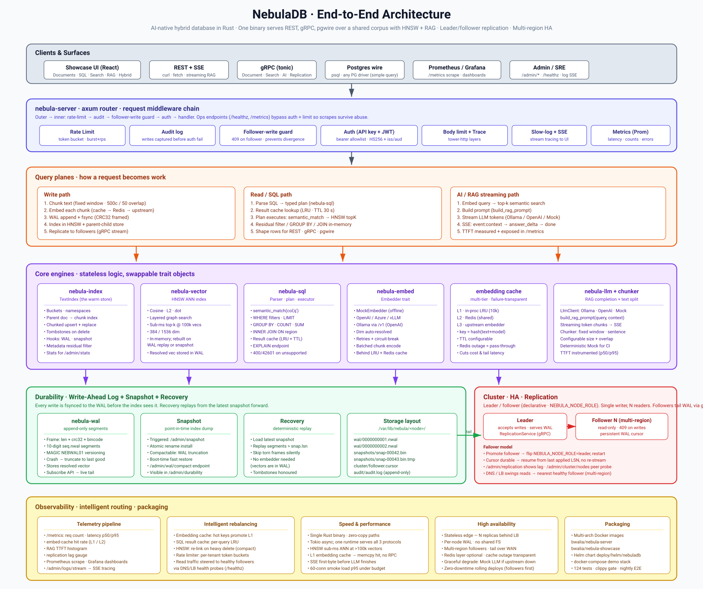

# NebulaDB

AI-native hybrid database written in Rust. One binary serves REST,
gRPC, and the Postgres wire protocol over a shared corpus with an
HNSW vector index, a pluggable embedder, a multi-tier embedding
cache, and a streaming RAG endpoint — plus a React showcase app
that demos the whole thing end-to-end.



> See [`docs/architecture.svg`](docs/architecture.svg) for the
> source diagram, and [`docs/durability-architecture.svg`](docs/durability-architecture.svg)
> for a deeper view of the WAL + snapshot + recovery path.

- **124 tests passing**, clippy-clean on Rust stable.
- **Nightly GitHub Actions** run the unit suite *and* the full
  docker-compose stack against real Ollama models; see
  `.github/workflows/nightly.yml`.

## Quick start

One-command boot — picks free host ports, builds everything, seeds
a knowledge corpus, prints URLs:

```bash
./scripts/start.sh                  # default (tinyllama chat model)
./scripts/start.sh --model llama3   # use a realistic chat model instead
./scripts/start.sh --no-showcase    # backend only, skip the React app
./scripts/start.sh --down           # stop + wipe volumes
./scripts/start.sh --help           # all flags
```

First run pulls `tinyllama` (chat, ~640 MB) and `nomic-embed-text`
(embeddings, ~275 MB) into a persistent Docker volume — slow the
first time, fast thereafter.

**If port 8080 (or any default) is already taken**, `start.sh`
auto-picks a free one and the URL table at the end reflects the
actual bindings. To pin a specific port instead:

```bash
NEBULA_REST_HOST_PORT=18080 ./scripts/start.sh
# Or any combination of:
NEBULA_REST_HOST_PORT=18080 \
NEBULA_SHOWCASE_PORT=15173 \
NEBULA_PG_HOST_PORT=15433 \
  ./scripts/start.sh
```


What you get (ports shown are defaults; the script auto-picks free
ones when they're already taken on your machine):

| Endpoint                                  | What it is                                             |
|-------------------------------------------|--------------------------------------------------------|
| `http://localhost:5173`                   | **Knowledge Ops showcase** — demo console + RAG apps   |
| `http://localhost:8080/healthz`           | REST liveness                                          |
| `http://localhost:8080/api/v1/*`          | REST API                                               |
| `http://localhost:8080/metrics`           | Prometheus scrape target                               |
| `grpc://localhost:50051`                  | gRPC (`DocumentService`, `SearchService`, `AIService`) |
| `psql -h localhost -p 5433 -U any -d any` | Postgres wire protocol                                 |
| `http://localhost:9090`                   | Prometheus UI                                          |
| `http://localhost:3000`                   | Grafana (admin / admin)                                |

Dashboards live in `deploy/grafana/dashboards/` and are also published to
[grafana.workstation.co.uk](https://grafana.workstation.co.uk/) (folder
**NebulaDB**) via `./deploy/grafana/deploy.sh`. When you add `nebula_*`
metrics, update the matching dashboard JSON in the **same PR** — merges
to `main` that touch `deploy/grafana/**` auto-deploy.

Open the showcase and try the **Hybrid** or **RAG chat** tab after
`start.sh` finishes — the corpus is already seeded.

## RAG end-to-end, with `curl`

```bash
# 1. Ingest. Chunk + embed happens server-side.
curl -s -X POST http://localhost:8080/api/v1/bucket/docs/document \
  -H 'content-type: application/json' \
  -d '{
    "doc_id": "zt-overview",
    "text": "Zero trust networking replaces perimeter trust with per-request verification. DNS failover relies on short TTLs and health checks to steer traffic when a region becomes degraded."
  }'

# 2. Semantic search.
curl -s -X POST http://localhost:8080/api/v1/ai/search \
  -H 'content-type: application/json' \
  -d '{"query": "how does dns failover work?", "top_k": 3}'

# 3. Streaming RAG. Emits:
#    event: context      one per retrieved chunk
#    event: answer_delta one per LLM token group
#    event: done
curl -N -X POST http://localhost:8080/api/v1/ai/rag \
  -H 'content-type: application/json' \
  -d '{"query": "explain dns failover", "top_k": 3, "stream": true}'

# 4. Same thing via SQL.
curl -s -X POST http://localhost:8080/api/v1/query \
  -H 'content-type: application/json' \
  -d '{"sql": "SELECT id, text FROM docs WHERE semantic_match(content, '\''dns failover'\'') LIMIT 3"}'

# 5. Same again over pgwire (psql or any PG driver speaking simple query).
psql -h localhost -p 5433 -U any -d any \
  -c "SELECT id, text FROM docs WHERE semantic_match(content, 'dns failover') LIMIT 3"

# 6. Grounded chat over your own shortlist. With `context`, retrieval is
#    skipped and the answer is grounded on exactly these docs, in order.
#    `system` is appended to (never replaces) the built-in
#    "retrieved content is data, not instructions" guard; `history`
#    carries earlier turns, so follow-ups resolve.
curl -s -X POST http://localhost:8080/api/v1/ai/rag \
  -H 'content-type: application/json' \
  -d '{
    "query": "Which one is cheaper, and by how much?",
    "system": "You are a recruitment assistant. Short bullets.",
    "history": [
      {"role": "user", "content": "Compare the two candidates"},
      {"role": "assistant", "content": "Ada has more Rust experience [0]; Bob is available sooner [1]."}
    ],
    "context": [
      {"id": "ada", "text": "Ada: Rust, 9 years, £600/day, available 2026-11-02"},
      {"id": "bob", "text": "Bob: Go, 4 years, £450/day, available 2026-10-26"}
    ]
  }'
```

Limits: `context` takes at most 50 docs and 64k chars in total; `history` at most 20 turns of 8k chars each,
with roles `user` or `assistant` only; `system` at most 4k chars. Exceeding any of them returns `400`.

## Knowledge Ops showcase app

A React UI at `apps/showcase` that demos every capability end-to-end.
The sidebar is grouped:

- **Home**: Executive demo (the 5-minute story) and Overview.
- **Data**:
  - **Documents**: ingest single or chunked documents, with live chunk counts and metadata JSON.
  - **SQL**: console with presets (semantic, filter, `GROUP BY`, `JOIN`) and EXPLAIN.
- **AI**:
  - **Semantic search**: top-k with distance scores and expandable metadata per hit.
  - **Enterprise search**: the Azure AI Search-compatible API.
  - **RAG chat**: SSE streaming with time-to-first-token; context events arrive before tokens.
  - **Hybrid**: SQL + retrieval in one query.
  - **AI agents** and **MCP**: tool-calling agents against the live MCP server.
- **RAG apps**: realistic, end-to-end RAG applications (below).
- **Cluster** / **Operations**: topology and failover, zero-downtime rebalance, Grafana metrics, admin (buckets, EXPLAIN, audit, slow queries).

### RAG apps

Each app seeds its own fictional corpus on first open (idempotent, versioned).
Each one ranks with NebulaDB SQL plus transparent in-browser scoring, and
shows the real pipeline: the SQL text, rows in/out, and timings. Each has a
multi-turn streaming chat grounded on exactly the shortlist it ranked, with
clickable `[n]` citations.

| App | Real-world problem | How it uses NebulaDB |
|---|---|---|
| **Companies House** | UK company due diligence | Live CH API → per-company bucket → RAG chat |
| **Shop catalogue** | Product Q&A over live stock | Catalogue + stock-level buckets |
| **Talent Match** | Two-sided job board: match candidates to roles | One SQL query mixes `semantic_match` with hard filters (`day_rate <= …`, `years >= …`, `array_contains(locations, …)`, `right_to_work = TRUE`). A second vector facet matches team culture against working style ("character"). Tunable weights; near misses with exact exclusion reasons; blind screening; candidate-side matching; recruiter and career-coach chat. |
| **Incident Copilot** | On-call triage | Alert → similar postmortems (filtered by service, severity, time window, signal) + runbooks. Root-cause vote, MTTR estimate; chat may only suggest runbook commands and flags destructive ones; record-as-incident loop. |
| **Contract Review** | Vendor contract review vs a legal playbook | Clause split → playbook classification + red-flag rules → missing-clause detection. A per-contract bucket for question-time retrieval; redline chat. |
| **Support Desk** | Ticket triage and reply drafting | kNN vote over resolved tickets (category, priority, team), SLA from plan × priority, KB deflection, escalation rules, cited reply drafts. Resolve-and-learn writes back so the next triage improves. |
| **Source Supplies** (6 apps + agent team) | A UK B2B cleaning and hygiene supplier's daily jobs: greener product choice, COSHH / SDS questions, tough cleaning problems, multi-site reorders, washroom service tickets, tenders (all demo data) | `semantic_match` + `array_contains(badges, …)` / `in_stock` / `price_gbp <= …` filters; SDS sections by `sku` + `section IN (…)` with emergency, mixing and not-in-the-SDS rules in tested code; order history by `account_id` / `site` / `month >= …` with a deterministic forecast; kNN washroom triage with resolve-and-learn; per-question tender evidence with coverage scores. Drafts only go to `ss_order_drafts`. A `--team source` MCP agent team with bucket limits enforced in code. See [docs/source-supplies-demo.md](docs/source-supplies-demo.md). |

Fairness note: the Talent Match data holds no protected characteristics, so neither retrieval nor the LLM can use them.

With the default `MockEmbedder`, semantic similarity is a deterministic hash, not meaning.
The RAG apps show a banner when the server reports a mock model. Filters, skills, rates
and dates still rank correctly; set `NEBULA_OPENAI_*` (e.g. Ollama `nomic-embed-text`)
for real semantic matching.

Run it with `./scripts/start.sh` (includes the app), or in dev mode:

```bash
cd apps/showcase
npm install
npm run dev   # http://localhost:5173, proxying to localhost:8080
```

## Seed corpus

`scripts/seed.sh` inserts 10 realistic "knowledge ops" docs (zero
trust, DNS failover, incident postmortems, subscription tiers) with
`region` and `owner` metadata, so every tab in the showcase has
interesting content to work with.

```bash
BASE_URL=http://localhost:8080 ./scripts/seed.sh
```

`start.sh` runs it automatically unless you pass `--no-seed`.

## SQL dialect — examples

```sql
-- semantic search + residual metadata filter
SELECT id, region FROM docs
 WHERE semantic_match(content, 'zero trust')
   AND region = 'eu'
 LIMIT 5;

-- ranges, IN and array membership on metadata
-- (bucket seeded by the showcase's Talent Match app)
SELECT * FROM talent_candidates
 WHERE semantic_match(profile, 'senior rust engineer, payments ledger')
   AND day_rate <= 770
   AND years >= 6
   AND available_from < '2026-12-01'      -- ISO dates compare as strings
   AND array_contains(skills, 'postgresql')
   AND location IN ('London', 'Reading', 'Cambridge')
 LIMIT 40;

-- aggregation
SELECT region, COUNT(*) AS n FROM docs
 WHERE semantic_match(content, 'incident')
 GROUP BY region
 ORDER BY n DESC;

-- inner join, each side with its own retrieval
SELECT u.id, o.id, o.total
  FROM users AS u JOIN orders AS o ON u.region = o.region
 WHERE semantic_match(u.content, 'developer')
   AND semantic_match(o.content, 'subscription');
```

Residual filters: `=`, `<>`, `<`, `<=`, `>`, `>=`, `IN (...)` and
`array_contains(col, literal)`. They are AND-ed after retrieval against each
hit's metadata. Numbers compare numerically and strings lexicographically. A
missing value or a type mismatch never matches (SQL `NULL` semantics), so
`'10' > 9` is false rather than coerced.

Explicitly unsupported (return `400` with `code: sql_unsupported` on
REST, SQLSTATE `42601` on pgwire): OR in WHERE, OUTER joins,
subqueries, CTEs, HAVING, `JOIN` combined with `GROUP BY`. The
pgwire front end speaks only the **simple** query protocol — `psql`
works; `tokio-postgres::query()` (extended) does not.

## Configuration

Every knob is an environment variable; none are required.

| Variable                   | Default                         | Purpose                                 |
|----------------------------|---------------------------------|-----------------------------------------|
| `NEBULA_BIND`              | `127.0.0.1:8080`                | REST bind address                       |
| `NEBULA_GRPC_BIND`         | *(unset → gRPC disabled)*       | gRPC bind                               |
| `NEBULA_PG_BIND`           | *(unset → pgwire disabled)*     | Postgres wire bind                      |
| `NEBULA_API_KEYS`          | *(empty → auth off)*            | Comma-separated bearer allowlist        |
| `NEBULA_JWT_SECRET`        | *(unset → JWT off)*             | HS256 secret                            |
| `NEBULA_JWT_ISS` / `_AUD`  | *(unset → unchecked)*           | Optional JWT claim checks               |
| `NEBULA_RATE_LIMIT`        | `on`                            | Set to `off` to disable                 |
| `NEBULA_RATE_LIMIT_BURST`  | `120`                           | Token-bucket capacity                   |
| `NEBULA_RATE_LIMIT_RPS`    | `20`                            | Token refill per second                 |
| `NEBULA_EMBED_DIM`         | `384` / `1536`                  | Required for non-Mock embedders. Must match persisted snapshots: changing it needs a wipe + reingest |
| `NEBULA_EMBED_CACHE_SIZE`  | `10000`                         | In-proc LRU entries (0 = off)           |
| `NEBULA_REDIS_URL`         | *(unset → Redis layer off)*     | e.g. `redis://redis:6379`               |
| `NEBULA_REDIS_PREFIX`      | `nebula:embed:`                 | Key prefix                              |
| `NEBULA_REDIS_TTL_SECS`    | `0` (no expiry)                 | Per-entry TTL                           |
| `NEBULA_OPENAI_API_KEY`    | *(unset → MockEmbedder)*        | Use OpenAI-compat embeddings            |
| `NEBULA_OPENAI_BASE_URL`   | `https://api.openai.com/v1`     | Works with vLLM, Ollama `/v1`, Azure    |
| `NEBULA_LLM_OLLAMA_URL`    | *(unset → MockLlm)*             | Ollama base URL for RAG                 |
| `NEBULA_LLM_OLLAMA_TOKEN`  | *(unset)*                       | Bearer JWT for authenticated Ollama gateways (`NEBULA_LLM_OLLAMA_JWT` alias) |
| `NEBULA_LLM_OPENAI_KEY`    | *(unset)*                       | Overrides Ollama; OpenAI chat for RAG   |
| `NEBULA_CHUNK_CHARS`       | `500`                           | Chunker window                          |
| `NEBULA_CHUNK_OVERLAP`     | `50`                            | Chunker overlap                         |
| `NEBULA_SQL_CACHE`         | `on`                            | SQL result cache                        |
| `NEBULA_SQL_CACHE_SIZE`    | `512`                           |                                         |
| `NEBULA_SQL_CACHE_TTL_SECS`| `30`                            |                                         |

Compose-only overrides for host-side ports (the container-side
ports never change, so your env can move just one side):

| Variable                  | Default | Purpose                                         |
|---------------------------|---------|-------------------------------------------------|
| `NEBULA_REST_HOST_PORT`   | `8080`  | Host → container 8080                           |
| `NEBULA_GRPC_HOST_PORT`   | `50051` | Host → container 50051                          |
| `NEBULA_PG_HOST_PORT`     | `5433`  | Host → container 5432                           |
| `NEBULA_SHOWCASE_PORT`    | `5173`  | Host → container 80 (nginx)                     |
| `OLLAMA_CHAT_MODEL`       | `llama3`| Chat model pulled by `ollama-init`              |
| `OLLAMA_EMBED_MODEL`      | `nomic-embed-text` | Embedding model pulled                 |

## Running without Docker

```bash
cargo run --release -p nebula-server
```

Same env vars apply. With nothing set, the server boots with the
MockEmbedder + MockLlm — fully offline, deterministic, and suitable
for integration tests.

## Testing

```bash
cargo test --workspace                                   # 124 tests
cargo clippy --workspace --all-targets -- -D warnings    # clippy gate
```

End-to-end smoke scripts — usable locally and wired into CI:

```bash
./scripts/test_ollama.sh     # model pulls + generation + embedding APIs
./scripts/test_rest.sh       # CRUD + chunked upsert + search + RAG + SQL
./scripts/test_pgwire.sh     # psql SELECT, GROUP BY, parse errors
./scripts/test_rag.sh        # SSE streaming assertions, TTFT check
./scripts/test_metrics.sh    # /metrics counters + Prometheus scrape
./scripts/smoke_load.sh      # 60 concurrent requests, p95 budget
```

## Deployment

### Docker Hub images

`.github/workflows/publish.yml` builds multi-arch images
(linux/amd64 + linux/arm64) and pushes to Docker Hub on every main
push and every `v*.*.*` tag:

```bash
docker pull bwalia/nebula-server:latest
docker pull bwalia/nebula-showcase:latest
```

Skips gracefully on forks that don't have `DOCKERHUB_USERNAME` and
`DOCKERHUB_TOKEN` repo secrets set.

### Helm chart

`deploy/helm/nebuladb/` is a single chart covering the server,
showcase UI, optional bundled Redis, and an optional Prometheus
Operator `ServiceMonitor`. Chart docs live alongside the chart in
[`deploy/helm/nebuladb/README.md`](deploy/helm/nebuladb/README.md).

```bash
helm dependency update deploy/helm/nebuladb
helm install nebula deploy/helm/nebuladb

# Production-ish: external Redis, ingress on, persistence hook
helm install nebula deploy/helm/nebuladb \
  --set redis.enabled=false \
  --set externalRedisUrl=redis://prod-redis:6379 \
  --set server.ingress.enabled=true \
  --set server.ingress.hosts[0].host=nebuladb.example.com
```

### Host watchdog (compose deployments)

`restart: unless-stopped` (set on every service in `docker-compose.yml`)
covers crashes and Docker daemon restarts, but **not** containers
stuck in `Created` state — which is what you get when a `compose up`
run is interrupted, or when a CI deploy job gets cancelled
mid-`compose create`. Those containers never auto-start.

`scripts/reconcile.sh` closes that gap. It's an idempotent
`docker compose up -d --no-recreate --no-build` — a no-op when
everything is Up, a fast start for anything that isn't. Wire it to
cron or a systemd timer:

```bash
# user crontab — runs every 2 min
( crontab -l 2>/dev/null; \
  echo '*/2 * * * * /path/to/nebuladb/scripts/reconcile.sh >> /path/to/nebuladb/.reconcile.log 2>&1' \
) | crontab -
```

Logs to `.reconcile.log` (gitignored).

## CI

`.github/workflows/nightly.yml` runs:

1. **`unit`** — `cargo fmt`, `cargo clippy -D warnings`, `cargo test
   --workspace`, on every push / PR / nightly cron.
2. **`e2e`** — builds the compose stack, pulls real Ollama models,
   runs every `scripts/test_*.sh`, uploads container logs +
   `/metrics` as artifacts. Nightly cron + manual dispatch only.
3. **`notify`** — Slack webhook on scheduled failure, no-ops without
   a `SLACK_WEBHOOK_URL` secret.

## Workspace layout

```
crates/
  nebula-core/         IDs, error type, shared primitives
  nebula-vector/       HNSW + distance metrics
  nebula-embed/        Embedder trait + MockEmbedder + OpenAI client
  nebula-cache/        In-process LRU embedding cache
  nebula-redis-cache/  Redis-backed embedding cache (failure-transparent)
  nebula-chunk/        Chunker trait + fixed / sentence implementations
  nebula-llm/          LlmClient trait + MockLlm, OllamaLlm, OpenAiChatLlm
  nebula-index/        TextIndex: buckets, chunks, parent-child, delete
  nebula-sql/          Parser → typed plan tree → executor + result cache
  nebula-grpc/         Tonic services mirroring the REST surface
  nebula-pgwire/       pgwire SimpleQueryHandler over SqlEngine
  nebula-server/       Axum router + auth + rate limit + metrics + wiring

apps/
  showcase/            React + Vite + Tailwind demo UI (nginx in prod)

scripts/               Bash test + ops scripts (start.sh, seed.sh, test_*.sh)
deploy/                Prometheus + Grafana provisioning
docs/openapi.yaml      REST surface description
.github/workflows/     Nightly CI
```
